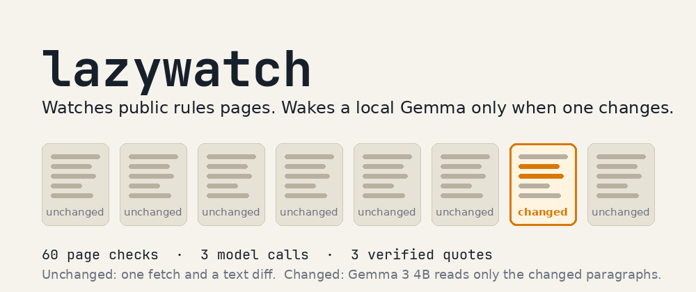

# lazywatch



Watch the public rules pages you care about without reading them. Once a day a job fetches each page. If nothing changed, the model is never called. If something changed, a local open-weight model (Gemma 3 4B through Ollama) summarises only the changed paragraphs, and the summary is kept only if its quote appears word for word in the new page text. Otherwise you get the raw change, clearly marked unverified. Once a week you read one short markdown digest.

Nothing leaves your machine except the page fetches.

## Run it (the basics, nothing to sign up for)

```
ollama pull gemma3:4b
copy sites.example.json sites.json        # then edit the URLs
python lazywatch.py check                 # run daily; first run only stores snapshots
python lazywatch.py digest --days 7 > digest.md
python lazywatch.py peek                  # what each snapshot actually holds
python -m unittest                        # 20 tests, no model, no accounts needed
```

Python 3.9+, standard library only. Windows Task Scheduler or cron can run `check` daily.

## Replicate the results on a clean PC

This is the full path from an empty Windows machine to the numbers in the write-up (page checks, model wakes, verified quotes, the Temporal retry and worker-kill demos, the Browserbase comparison and the Tiger Data search). Commands are PowerShell; on macOS or Linux use the same commands with `cp` for `copy` and `export NAME=value` for `$env:NAME = "value"`.

**1. Install the tools**

- Python 3.9 or newer, with `python` on the PATH.
- [Ollama](https://ollama.com), then the two open-weight models:

  ```
  ollama pull gemma3:4b
  ollama pull embeddinggemma
  ```

  A GPU with 4 GB of memory runs Gemma 3 4B comfortably; it also runs on CPU, just slower (a cold start took about 45 s on the laptop used for the write-up, a warm call about 12 s).
- The [Temporal CLI](https://docs.temporal.io/cli) (`temporal.exe`), for the durable version. Open source, no account.
- Git.

**2. Get the code and the Python packages**

```
git clone https://github.com/habsology/lazywatch
cd lazywatch
pip install temporalio browserbase playwright "psycopg[binary]" pgvector
```

`temporalio` is for the workflow, `browserbase` and `playwright` for the JavaScript pages, `psycopg` and `pgvector` for the Tiger Data memory. Each is optional: the tool keeps working when a package or its service is missing, and the tests skip what is not installed. No local browser download is needed; Browserbase runs the browser.

**3. Choose the pages**

```
copy sites.example.json sites.json
```

`sites.example.json` is the list used for the write-up: short-term rental rules for Montreal, Toronto and British Columbia, Airbnb's hosting page for Canada, the Canada Gazette Part I index, the Government of Canada news page, the federal travel advisories, and the Environment Canada weather feed for Montreal as the control page (it changes every hour, so the model has to wake up for it). Keep it or edit it. A page marked `"render": true` always goes through Browserbase; `"render": "auto"` tries the plain fetch first.

**4. Run the plain version once**

```
python lazywatch.py check      # first run: snapshots only
python lazywatch.py peek       # confirm each snapshot holds real text, not a "needs JavaScript" shell or a 404 page
```

Pages marked `"render"` need Browserbase (step 6); without the key they fail and the rest still run.

**5. The durable version (Temporal)**

Three terminals:

```
temporal server start-dev                # terminal 1, leave it running; UI at http://localhost:8233
python lazywatch_temporal.py worker      # terminal 2, leave it running
python lazywatch_temporal.py once        # terminal 3: one full check, every page as its own activity
```

`once` prints one line per page and exits. Run it once a day (or `python lazywatch_temporal.py schedule` creates a 06:00 daily schedule in the dev server). Every run, attempt and failure is in the UI.

The two demos from the write-up:

- **A dead page is retried, then reported, and the rest still finish.** `python lazywatch_temporal.py once sites.demo-retry.json` checks `example.invalid`: 5 attempts with 10 s backoff doubling (about 2 min 31 s), then "failed after 5 attempts". With the real list, add that entry to `sites.json` to see the other pages complete around it.
- **A killed worker loses nothing.** Start `once`, and about 10 seconds in close the worker terminal (Ctrl+C, or `Stop-Process` on it). The activity it was running fails with it. Start `python lazywatch_temporal.py worker` again: the workflow resumes on the new worker, retries only that activity, and the finished pages are not fetched twice. The UI's event history shows the failed attempt and the retry.

**6. JavaScript pages (Browserbase)**

Create a free Browserbase account, then in the terminal that runs the worker or the check:

```
$env:BROWSERBASE_API_KEY = "your key"
$env:BROWSERBASE_PROJECT_ID = "your project id"     # only if your dashboard shows one
python lazywatch_browser.py compare https://www.canada.ca/en/news.html
```

`compare` prints how many paragraphs the plain fetch saw against the real browser. On our runs the plain fetch of that page was refused and the browser read 190 paragraphs. With the key set, `check` and `once` use the browser for any page marked `"render"`.

**7. Memory and search (Tiger Data)**

Create a Tiger Cloud Postgres service (the free tier is enough; pgvector is available on it), copy its connection string, then:

```
$env:TIGER_DATABASE_URL = "postgres://..."
python lazywatch_store.py init           # tables and the vector extension
python lazywatch_store.py backfill       # optional: load the checks already in state/
python lazywatch_store.py stats          # pages, checks, model wakes
python lazywatch_store.py search "licence fee"
python lazywatch_store.py search "is it getting colder outside"
```

With the variable set, every `check` or `once` records each page check and each change (with an embedding from embeddinggemma). `search` fuses full-text rank and pgvector cosine rank with reciprocal rank fusion, so a paraphrase with no word in common still finds the change. Without the variable, lazywatch keeps working from the local `state/` folder.

**8. Read the result**

```
python lazywatch.py digest --days 7 > digest.md
```

The first line is the effort line: `N page checks in 7 days, model woken M times.` Then one entry per change, with the model's sentence and its quote, or the raw diff marked NOT verified. Your numbers will differ from the write-up's, because they depend on when your pages change; the weather feed is there so that at least one page always does.

## Durable version (Temporal), in short

`lazywatch_temporal.py` runs the same check as a Temporal workflow: one activity per site with its own retry policy (5 attempts, 10 s backoff doubling); a page that is dead after 5 attempts is reported, and the other pages still run, so a slow page or a model that is still loading is retried on its own, and a crash halfway through a run resumes with the finished sites kept. Everything stays on your machine with the free local dev server.

## JavaScript pages (Browserbase), in short

Some rules pages render their text in the browser, so a plain fetch sees almost nothing. Mark those `"render": true` in `sites.json` and lazywatch opens them in a real browser on Browserbase. `"render": "auto"` tries the plain download first and switches to the browser only if the page refuses it (a 404 is not a refusal: a dead page stays dead instead of snapshotting the error page); the choice is remembered so later checks compare like with like. If a page's fetch path ever changes, its first snapshot on the new path replaces the old one and no change is reported, because a plain fetch and a browser see different text.

## Limits

- It compares page text. A page that renders its rules with JavaScript looks empty to the plain fetch; mark it `"render": true` so it goes through the real browser. `python lazywatch.py peek` shows what each snapshot holds, so you can tell a real page from a "please enable JavaScript" shell.
- Atom and RSS feeds work as pages: each entry's title and summary become one paragraph each. Feeds must stay on the plain fetch (no `render` key), since a browser would show its XML viewer instead.
- A 4B model can misread a change. The verbatim-quote check catches invented text, not a wrong interpretation, so read the quote.
- Be polite: one fetch per page per day, and respect each site's terms.

MIT licence.
